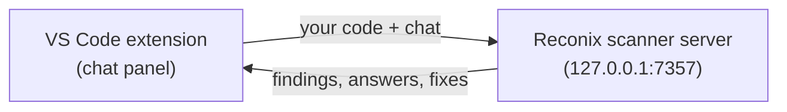

# Reconix Code Scanner

A security scanner you use from a chat panel in VS Code. You type what you want — like
"scan this project" or "fix all high findings" — and the findings land in the editor, the
Problems panel, and a Findings tree, each with an explanation and a suggested fix.

Everything runs locally: a bundled scanner server on `127.0.0.1:7357` and the VS Code
extension that talks to it. No Docker, no accounts, no API keys, and nothing leaves your
machine.

## How it works



| Part | What it does |
| --- | --- |
| [**VS Code extension**](extension/) | The chat panel. Sends the open folder to the server, shows findings in the editor, and applies fixes you accept. |
| **Scanner server** | Bundled in [`extension/server/`](extension/server/). Serves findings and answers chat over a local connection. Started with `npm run server`. |
| [**`vuln-shop/`**](vuln-shop/) | A small, intentionally vulnerable sample project — one planted issue per file — for trying the scanner. |

## Quick start

```sh
./setup.sh                                   # builds + installs the extension, points it at the server
cd extension && npm run server        # starts the scanner server on :7357 (token: test-token)
```

Then in VS Code:

1. **Developer: Reload Window** (Command Palette).
2. Open a folder to scan — [`vuln-shop/`](vuln-shop/) is a ready-made sample.
3. Click the **shield icon** in the activity bar, or right-click a file/folder → **Scan with Reconix**.

Findings appear in the panel, as squiggles in the code, and in the Problems panel. Click one
to jump to its line.

`setup.sh` works on Linux, macOS and Windows (on Windows, run it in **Git Bash**). It needs
[Node.js](https://nodejs.org/) 20+, [VS Code](https://code.visualstudio.com/) with the `code`
command on your PATH, and Python 3. See [docs/SETUP.md](docs/SETUP.md) to do it by hand or to
set `reconix.serverUrl`/token yourself.

## What you can do

- **Scan by chat.** "scan this project", "scan only src/auth", "rescan". A rescan uploads only
  the files that changed since the last scan.
- **Read the findings.** Each one has a severity, a CWE, a plain-language explanation of why it
  matters, and a suggested fix. They're grouped by severity, then by file.
- **Get a summary.** After a scan, a card shows the counts, the most affected files, and the
  top things to fix first.
- **Fix with the agent.** Click **Fix** or **Fix all**, or type "fix all high findings". You
  see every change as a diff and nothing is saved until you click **Apply**.
- **Ask questions.** "why is this a problem?", "how do I fix finding abc123?".

## Settings

| Setting | Default | What it does |
| --- | --- | --- |
| `reconix.serverUrl` | `http://127.0.0.1:7357` | Base URL of the scanner server. |
| `reconix.token` | empty | Paste a token here to sign in; it moves to secure storage and the field is cleared. |
| `reconix.caCertificate` | empty | Full path to a PEM certificate to trust for HTTPS (for a self-signed server). |
| `reconix.extraExcludes` | `[]` | Extra files or folders to skip, in `.gitignore` style, e.g. `["data/", "*.min.js"]`. |
| `reconix.maxFileSizeKB` | `2048` | Skip files bigger than this. |
| `reconix.maxUploadMB` | `200` | Stop before uploading more than this. |
| `reconix.showLikelyFalsePositives` | `false` | Show findings marked as likely false alarms. |

Folders like `.git`, `node_modules`, `dist`, `build` and `.venv`, and everything in your
`.gitignore`, are never uploaded. The full settings list is in
[`extension/README.md`](extension/README.md).

## Project layout

```
scanner/
├── setup.sh              one-command setup
├── extension/     the VS Code extension (TypeScript) + bundled server/
├── vuln-shop/            intentionally vulnerable sample project
└── docs/
    └── SETUP.md          setup by hand, HTTPS, troubleshooting
```

## For developers

```sh
cd extension
npm ci
npm run build              # bundle with esbuild into dist/
npm run test:unit          # plain Node tests
npm run test:integration   # opens a VS Code window for a short time
npm run server             # start the scanner server on :7357 for trying the UI by hand
```

More detail — the extension's commands, the editor features, and how a scan flows through the
code — is in [`extension/README.md`](extension/README.md).

## Your code and data

- The open folder is sent only to the local scanner server; nothing leaves your machine.
- Secrets detected in the code are masked as `****` in snippets and reports.
- Tokens and keys are never written to logs.
